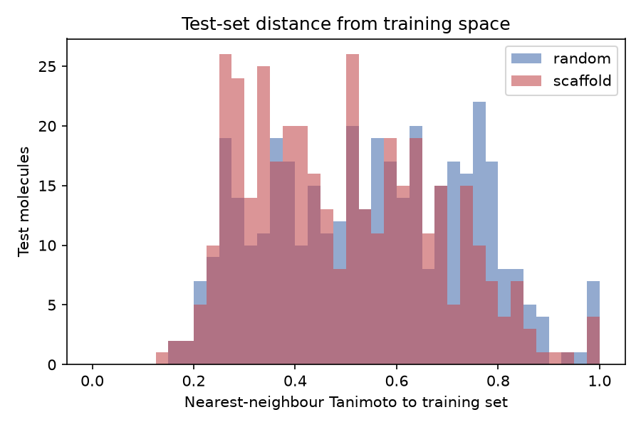
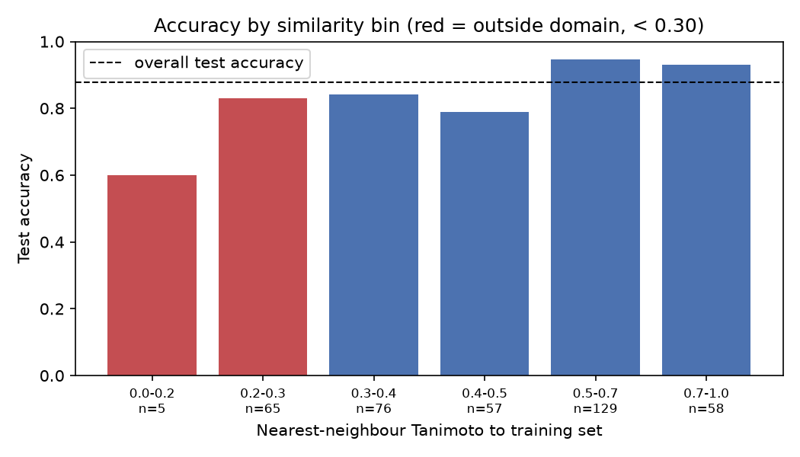

# BBB permeability prediction with scaffold-split evaluation

Blood-brain-barrier permeability classifier on [TDC BBB_Martins](https://tdcommons.ai/single_pred_tasks/adme/#bbb-blood-brain-barrier-martins-et-al),
built to show what random train/test splits hide and what an applicability-domain
check adds. Morgan fingerprints, XGBoost, FastAPI service.

The point of this repo is not the model. It is the evaluation.

---

## The result

Mean ± std over five seeds, 1,950 molecules after deduplication.

| Split | AUROC | AUPRC (non-permeable) |
|---|---|---|
| Random | 0.924 ± 0.015 | 0.820 ± 0.028 |
| **Scaffold** | **0.897 ± 0.026** | **0.769 ± 0.028** |

Random splits overstate AUROC by 0.027 and minority-class AUPRC by 0.051.
All headline numbers use the scaffold split.

**Why:** in a random split, 163 of 390 test molecules (42%) share a Bemis-Murcko
scaffold with a training molecule. Under the scaffold split that number is zero
by construction. The model is partly being asked to recognise analogs it has
already seen.

AUPRC is reported on the non-permeable class. The dataset is 76.5% permeable, so
positive-class AUPRC has a no-skill baseline of 0.765 and sits at 0.95–0.98 for
every model here, including ones that are barely better than chance at the task
that matters. Minority-class baseline is 0.235.



---

## Applicability domain

Every prediction returns a nearest-neighbour Tanimoto similarity to the training
set and an `in_domain` flag. Accuracy is strongly similarity-dependent:

| NN Tanimoto | n (test) | Accuracy |
|---|---|---|
| 0.0–0.3 | 70 | 0.815 |
| 0.3–0.4 | 76 | 0.842 |
| 0.4–0.5 | 57 | 0.789 |
| 0.5–0.7 | 129 | 0.946 |
| 0.7–1.0 | 58 | 0.931 |

The threshold (0.30) is fitted on the **validation** split, never on test.
On validation, accuracy holds at 0.91–0.96 above 0.3 and falls to 0.78 below it.

Validation and test disagree about where the boundary sits: validation breaks at
0.3, test breaks at 0.5 (0.79 → 0.95). Both are real. With 23–73 molecules per
validation bin, bin-level accuracy carries several points of noise, and this
disagreement is a fair measure of how precisely a threshold can be located at
this dataset size. The shipped threshold is the validation-fitted one; 0.5 is a
defensible stricter operating point, but adopting it retroactively because test
preferred it would be the same error this repo exists to criticise.



Training fingerprints are stored bit-packed (`np.packbits`, 256 bytes/molecule,
68 KB total). Similarity is a single vectorised `np.bitwise_count` operation —
no FAISS, no index.

---

## Two findings about model selection

**Logistic regression matches XGBoost.** 0.891 ± 0.016 vs 0.897 ± 0.026 AUROC on
the scaffold split — well inside one standard deviation. On 2,048-bit Morgan
fingerprints with 1,365 training molecules, the boosted model buys nothing. No
GNN was trained; on a dataset this size it would not have changed this
conclusion.

**Validation is too small to select hyperparameters cleanly.** An unconstrained
grid search picked `max_depth=10`, improving validation AUROC by 0.002 while
costing 0.014 on test. Model selection now requires a more complex configuration
to beat the incumbent by 0.01 on validation before it is adopted, with grids
ordered simplest-first. That single change moved test AUROC from 0.874 to 0.886.

---

## API

```
GET  /health     liveness
GET  /model      version, metrics, training date, AD threshold
POST /predict    {"smiles": ["CCO", "..."]}
```

Response per molecule: `prediction`, `probability`, `in_domain`, `max_similarity`.

```bash
curl -X POST localhost:7860/predict \
  -H 'Content-Type: application/json' \
  -d '{"smiles":["CN1C=NC2=C1C(=O)N(C)C(=O)N2C"]}'
```

SMILES are parsed by RDKit in a Pydantic validator, so malformed input returns
422 before any model code runs.

---

## Reproducing

```bash
pip install -e .
python scripts/fetch_data.py      # downloads BBB_Martins from TDC
python -m bbb.train               # 2 models x 2 splits x 5 seeds -> results.csv
python scripts/analyze.py         # fits the AD threshold, writes figures/
pytest -q
```

Per-seed numbers are in `results.csv`; the fitted threshold and its validation
bins are in `artifacts/threshold.json`.

Run the service:

```bash
uvicorn bbb.api:app --port 7860
docker build -t bbb-admet . && docker run -p 7860:7860 bbb-admet
```

---

## Data handling

2,030 rows in, 1,950 out. Molecules are standardised with RDKit
(`Cleanup`, largest-fragment selection, uncharging) before anything else —
salt stripping matters, since a hydrochloride and its free base would otherwise
be distinct rows and could land on opposite sides of a split.

Deduplicated by InChIKey: 55 duplicate rows collapsed, 12 groups with
conflicting labels dropped outright rather than majority-voted (with 2–3 members
a vote is noise).

Acyclic molecules get their own scaffold group. `GetScaffoldForMol` returns an
empty core for anything without a ring system — 99 rows here — and lumping them
into a single `""` group would put 5% of the data in one bucket that is not a
scaffold and is not structurally coherent.

---

## Caveats

- The scaffold split here is not TDC's official benchmark split, and this repo
  deduplicates where the leaderboard does not, so the 0.897 figure is not
  directly comparable to leaderboard entries (which run roughly 0.73–0.92).
- Scaffold groups larger than half the validation target are forced into train,
  so the largest scaffold classes are always seen during training. This is the
  realistic deployment case and makes the split harder.
- Scaffold-split group order is seeded, unlike the usual size-sorted
  deterministic implementation. Without that, there is no variance to report,
  and the seed-to-seed spread (±0.026) is comparable to the effect being
  measured.
- Single dataset, single endpoint. Nothing here has been shown to generalise to
  other ADMET tasks.
